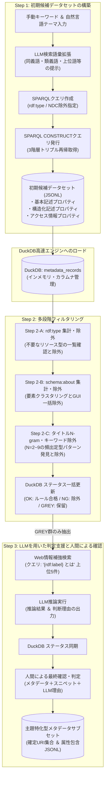

# ジャパンサーチを対象とした主題特化型メタデータサブセット構築支援システム「JPS-Refine Studio」の設計と実装

---

# アプリケーションの設計思想とその背景に存在する問題

## 1. 背景にある問題

### 1.1 分野横断型デジタルアーカイブにおける検索結果の肥大化と資料の死蔵
近年、国立国会図書館が主導する「ジャパンサーチ（Japan Search）」に代表される分野横断型のデジタルアーカイブ検索プラットフォームが発展し、国や自治体、大学、研究機関、民間アーカイブ等に分散していた膨大な文化資源メタデータの一括横断検索が可能となった。

しかし、大量の検索結果の下位に埋もれた資料は、利用者の目に触れることなく実質的に死蔵されているといっても過言ではない。デジタルアーカイブの統合検索が進むほど、検索結果は肥大化し、そのすべてにアクセスすることが困難になるというジレンマが存在する。このようなジレンマを解消し、利用者の探索的な資料検索・閲覧経験をより豊かにする方法の1つとして、特定の主題に関連する資料群のみを選択的に切り出した「メタデータサブセット」の構築が求められている。

### 1.2 ゆるやかなメタデータ方針と属性情報の非構造化
ジャパンサーチでは、多数の機関からのデータ統合を容易にするため、必須メタデータ項目を「ID（URI）」と「タイトル」のみとする、ゆるやかなメタデータ方針が採用されている。

そのため、分野固有の属性情報は往々にして構造化されず、`schema:description` などの汎用記述フィールドに自然言語のまま埋もれた状態となっている。したがって、特定の主題に関連する資料群を収集しようとして単純なキーワード検索を行うと、しばしば本来意図しない資料主題や無関係なジャンル、形態の資料がノイズとして混入し、対象である主題に関連した資料のみを取得することが困難となる。

例えば、「日本伝統音楽関連楽譜資料」を抽出しようとする場合、「譜」という文字が含まれる資料を検索すると、家系の系図である「系譜」「家譜」、人物の事績を年代順に記した「年譜」、絵手本である「画譜」、囲碁・将棋の手順書である「棋譜」、本草学の薬品目録である「薬譜」、さらには「介譜」「硯譜」「図譜」など、音楽資料とは全く無関係な資料群が大量にヒットし、対象領域の資料のみを選択的に抽出することが著しく困難となる。一方で、既知の楽器名（笛、笙、箏等）のみに絞り込んで検索した場合には、タイトルにそれらの語を含まない資料が取りこぼされ、再現率（Recall）が損なわれる。

### 1.3 AIによる自動生成の限界と手作業によるブラックボックス化
このような課題に対して、大規模言語モデル（LLM）を用いたメタデータの自動生成・補完アプローチが注目されているが、人文学資料の書誌同定においてAIに過度な自律性を与えた場合、ハルシネーション（幻覚）による誤同定のリスクが存在する。

一方で、研究者が手作業で検索とスプレッドシート上での削除を繰り返す従来のアドホックな選別手法では、どのような判断基準や手順で資料が除外されたのかというプロセスが暗黙知（ブラックボックス）化してしまう。

したがって、利用者が特定の主題に関する資料群を効率的かつ高密度に探索できるようにするためには、AIによる無批判な自動生成に頼るのではなく、適切な情報整理支援のもとで人間が主導して信頼性の高い「メタデータサブセット」を構築できるシステム環境が不可欠である。

---

## 2. システムの設計思想

上述した問題意識を踏まえ、本研究ではジャパンサーチから特定の主題に関連する資料群のみを切り出したメタデータサブセットを効率的に構築する「**JPS-Refine Studio**」の設計と実装に取り組んだ。

### 2.1 メタデータサブセットの本質的定義
本研究における「メタデータサブセット」の本質は、**特定の主題との関連が人間によって確認された資料URIの集合**である。

ただし、構築支援ツールとしては、その精査過程において人間が資料と主題との関連を判断するための材料として、対象URIに紐づく属性情報（例えば楽譜資料における音楽ジャンル、流派、楽器、時代などの情報を含む記述）を包含したJSONL（JSON Lines）形式のデータセットとしてこれを構築・保持する。これにより、単なる識別子のリストにとどまらず、後続の探索的検索や二次分析に直結する豊かな属性群が維持される。

### 2.2 ルールベースとLLM協調による「Human-in-the-Loop」アプローチ
本システムの基本思想は、**「AIによる自律的なメタデータの生成を避け、初期検索で広く集めた候補から不要なURIを人間が多段階に削ぎ落とすルールベースフィルタリングを軸とし、人間の判断を支援する情報整理ツールとしてLLMを協調させる」**という点にある。

1. **初期段階での再現率（Recall）優先**: 初期検索ではノイズの混入を許容し、対象主題に関連する可能性のある候補を漏れなくプールする。
2. **多段階の削ぎ落とし（ルールベース）**: メタデータの型（`rdf:type`）、主題（`schema:about`）、およびタイトル文字列（N-gram解析）の構造的特徴に基づき、人間が明確なルールを設定して不要なノイズを一括で除外する。
3. **境界線データのLLM支援**: ルールのみでは合否を断定できない「判定保留」データに限定し、外部Web検索スニペットを取り込んだLLMが推論結果と判断理由を提示する。
4. **人間による最終確認**: メタデータ記述、Webスニペット、およびLLMの判断理由を統合提示し、人間が最終的な採否を下す。

このパイプラインにより、初期候補の広範な網羅性を維持しながら、目視確認の対象となるデータ量を現実的な規模へと効率的に圧縮し、精度の高いサブセットの構築を可能にしている。

---

# 計画と実装

## システム全体アーキテクチャとデータフロー

JPS-Refine Studioは、StreamlitをベースとしたGUIを備え、メタデータの収集からフィルタリングまでの一連の工程をシームレスに進められるワークフロー環境である。

### ファイル入出力とDuckDB高速エンジンの内部統合
本ツールは外部連携用の入出力フォーマットとしてJSONLを採用しているが、初期候補が数万件規模に達した場合のメモリ効率とレスポンス速度を担保するため、システム内部にカラムナ型（列指向）インメモリデータベースであるDuckDBを高速処理エンジンとして統合している。

初期候補データセット（`raw_metadata.jsonl`）はDuckDBの `metadata_records` テーブルに一括インポートされ、以降のルール適用、出現頻度集計、および査読画面のページネーションがミリ秒単位のインメモリSQLによって実行される。これにより、数万件規模のメタデータであってもGUIが一切スタックせず、軽快な操作性を維持している。

本ツールのLLMバックエンドはOpenAI互換APIに対応しており、コストや機密性の要件に応じて商用API（Google Gemini API等）とローカルLLM（LM Studio等）を使い分けることができる。

システムにおけるデータ処理は、以下の3つの主要ステップから構成される。



---

## 初期候補データセットの構築 （Step 1）

### 1. 取得方針とSPARQLエンドポイントの利用
Step 1では、ジャパンサーチが提供するSPARQLエンドポイント（`https://jpsearch.go.jp/rdf/sparql/`）を利用し、対象となる主題に関連した資料を可能な限り漏れなく取得した初期候補データセットを構築する。

ここでは、**ノイズの混入を許容し、各アイテムをメタデータサブセットに取り込むか否かは、後半のフィルタリングで検討するというアプローチ**（Recall優先）を採用している。

### 2. LLMによる検索語彙拡張とクエリ作成支援
手動によるキーワード指定に加え、自然言語での主題・テーマの入力を踏まえてLLMが同義語、類義語、上位語など、関連する検索キーワードの候補を提示することで、より網羅的な検索クエリの作成を支援する（`modules/llm_query_expander.py`）。

例えば、「日本伝統音楽の楽譜資料」を対象とする場合、一般的な「楽譜」のみならず、各楽器名が付くもの（笛譜、笙譜、箏譜、三味線譜等）や、楽種名（雅楽、声明、能楽等）をLLMが提示する。

さらに、ジャパンサーチから事前に取得した `rdf:type` のマスターテーブル（記事・論文、公演、絵画、標本、行政文書等）と日本十進分類法（NDC）のリストを参照し、明らかに主題と無関係なクラスや大分類（自然科学、工学、産業等）をSPARQLの `FILTER NOT EXISTS` 句を用いて事前除外指定する。

検索述語には、Virtuosoトリプルストアが提供する高速全文検索述語 `bif:contains` を採用し、タイトル（`rdfs:label`, `schema:name`）、主題（`schema:about`）、件名（`schema:keywords`, `dct:subject`）、および説明文（`schema:description`）を網羅的に走査する。504タイムアウトを回避するため、キーワードは最大12語単位に自動分割（チャンク化）されて順次発行される。

### 3. CONSTRUCT句による3階層トリプルの再帰的取得
資料URIに紐づく属性情報を欠落なく取得するため、SPARQLの `CONSTRUCT` 句を使用し、資料URIを起点として**直接および間接に紐づく3階層のトリプル（親ノード・子ノード・孫ノード）を再帰的に取得**する（`modules/sparql_collector.py`）。

```sparql
PREFIX schema: <http://schema.org/>
PREFIX jps: <https://jpsearch.go.jp/term/property/>
PREFIX rdfs: <http://www.w3.org/2000/01/rdf-schema#>

CONSTRUCT {
    ?s ?p ?o .
    ?node ?p2 ?o2 .
    ?subnode ?p3 ?o3 .
}
WHERE {
    VALUES ?s { <URI_1> <URI_2> ... }
    ?s ?p ?o .
    OPTIONAL {
        ?s ?linkProp ?node .
        FILTER (ISBLANK(?node) || (ISURI(?node) && STRSTARTS(STR(?node), STR(?s))))
        ?node ?p2 ?o2 .
        OPTIONAL {
            ?o2 ?p3 ?o3 .
            FILTER (ISBLANK(?o2) || (ISURI(?o2) && STRSTARTS(STR(?o2), STR(?s))))
        }
    }
}
```

この再帰取得により、ジャパンサーチ利活用スキーマにおける以下の3層のプロパティ群を網羅したJSONL形式のグラフデータを構築・保持する。
- **基本記述プロパティ**: `rdfs:label`, `schema:name`, `schema:description`, `schema:about`, `rdf:type` 等
- **構造化記述プロパティ**: `jps:sourceInfo` 配下の所蔵館名、典拠情報、関連リンク（`rdfs:seeAlso`, `schema:relatedLink`）等
- **アクセス情報プロパティ**: `jps:accessInfo` 配下の公開URL、画像・IIIFマニフェストURI（`schema:associatedMedia`, `schema:url`）等

取得されたトリプル群は、`parse_dynamic_graph()` 関数によりツリー構造のネスト辞書に復元され、プロパティURIがQNameプレフィックス付き短縮名に正規化されて `raw_metadata.jsonl` に保存される。その後、DuckDBの `metadata_records` テーブルにバルクインサートされる。

---

## 多段階フィルタリング （Step 2）

収集した初期候補データセットに対して以下のフィルタリングを順次適用し、目視確認の対象となるデータ量を現実的な規模へと効率的に圧縮する。

### Step 2-A: rdf:type によるフィルタリング
初期候補データセットに含まれる `rdf:type`（資料種別・クラス情報）を集計し、各 `rdf:type` に含まれる実データの一覧を確認しながら不要な `rdf:type` を除外する（`views/step2_type_view.py`）。

提供機関ごとに完全URI（例: `https://jpsearch.go.jp/term/type/記事・論文`）で記述されている場合と短縮名で記述されている場合があるため、システムはURI末尾のローカル名を自動抽出し、双方で照合可能なマッピングテーブルを生成する（型が未定義の資料は「（未定義 / 種別なし）」として集計）。

**設計上の重要原則**: 本ステップでは、**誤合格（偽陽性）を防止するため、`rdf:type` による絞り込みにおいては「除外（NG）のみ」を適用し、OKルール（合格確定）は設けない**。「図書」や「和古書」といった種別を安易にOKとしてしまうと、その中に含まれる大量の異分野資料が後続の精査をすり抜けてしまうため、「記事・論文」「公演」「絵画」「彫刻」「工芸品」「絵葉書」「記録写真」といった明らかに非該当な大分類ノイズの削ぎ落としに限定して運用される。除外されたレコードには `type_status = 'NG'` がマークされ、後続ステップの評価母集団からバイパスされる（元データは保持）。

### Step 2-B: schema:about によるフィルタリング
`schema:about`（主題・件名・分類情報）に含まれる要素を集計・クラスタリングし、GUI上で主題と関連のないキーワードを一括除外する（`views/step2a_about_view.py`）。

出現する全Aboutキーワードをフラットに提示すると作業負荷が高くなるため、`cluster_about_keywords()` 関数により以下の階層クラスタリングを実施して可視化する。
1. **NDC分類クラスタ**: `extract_ndc_number()` により文字列からNDCコードを抽出し、国立国会図書館のNDC APIキャッシュと照合して公式ラベル（例: `768 [邦楽]`）を自動付与。
2. **NDLNA典拠クラスタ**: Web NDL Authoritiesの典拠IDを抽出し、人名・件名・団体名クラスタとして集約。
3. **階層区切り記号クラスタ**: 件名標目における区切り記号（`--`, `/`, `:`, `_`）を検出し、上位概念ごとにグループ化。
4. **プレフィックス・バケットクラスタ**: 残余のキーワードを先頭2文字の共通プレフィックスによってバケット分類。

判定関数 `match_about_keyword()` は、NDCコードの前方一致・包含関係を厳密に判定する。例えば、ユーザーがルールとして「76」を指定した場合、「760」「768（邦楽）」「768.1」等の下位区分が自動的に包含される。ユーザーはGUI上で無関係なキーワードやクラスタを選択し、一括で除外（NG）を設定できる。また、確実に対象主題である分類（例: `768: 邦楽`）に対してはOKルールを設定し、後続のLLM推論をスキップして合格確定とすることも可能である。

### Step 2-C: 資料タイトルを対象としたキーワード検索および検索結果に基づいた除外候補の指定
`rdf:type` や `schema:about` だけでは判別できない資料に対し、資料タイトルを対象としたキーワード検索及び検索結果に基づいた除外候補の指定を行う（`views/step2b_ngram_view.py`）。

1. **キーワード検索と除外指定**: タイトルに対するフリーワード検索を行い、ヒットした資料群を確認した上で一括除外パターンとして登録する。
2. **N-gram解析（N=2〜9）による定型パターンの抽出**: 資料タイトルから記号・数字・括弧類を除去した標準化文字列（`clean_title_text()`）に対し、$N=2 \sim 9$ の部分文字列（N-gram）を作成し、出現頻度順に提示する。これにより、「画譜」「年譜」「家譜」「系譜」「棋譜」「薬譜」「図譜」など、主題と関連のない定型パターンを効率的に発見・除外できる。
3. **親ルール優先判定によるルールの正規化**: 最短一致アルゴリズム（`get_parent_rule()`: $O(L^2)$）を実装し、すでに「画譜」が除外ルールにある場合は「北斎画譜」などの冗長な子ルールを追加せず、親ルールを優先適用してルールの肥大化を防止する。
4. **除外済み文字列を含む候補の動的非表示化**: 除外済み文字列を含む候補が画面上から動的に非表示化されるため、作業者が常に未処理かつ意味のある判定対象のみに取り組める環境が提供される。

登録された1,000件超の除外ルールは、単一の正規表現オートマトン（`re.compile("|".join(...))`）として一括コンパイルされ、DuckDBエンジンを通じて全件に対して瞬時に適用される。ルール除外にもルール合格にも該当しなかったレコードが「判定保留メタデータ（GREY群）」として抽出され、Step 3へ引き継がれる。

---

## LLMを用いた判定支援と人間による確認 （Step 3）

### 1. 判定保留メタデータに対するLLM推論支援
Step 2までで主題との関連を否定できない判定保留メタデータに対し、LLMを用いた判定支援を行う（`views/step2c_llm_view.py` および `modules/llm_classifier.py`）。

全件ではなく判定保留群に限定してLLMを適用することで、API通信コストや計算時間を最小限に抑制し、AIのハルシネーションによる誤判定の影響を局所化している。さらに、同一タイトルの古典籍が複数機関から登録されている場合には、タイトル正規化による名寄せ（Deduplication）を行い、最も説明文の長い代表1件のみを推論させて結果を展開する最適化を行っている。

### 2. Web検索スニペットによる外部知識のプロンプト注入
各資料について「`{rdf:label} とは`」をクエリとしてWeb検索を行い、取得した上位5件のスニペットを外部知識としてLLMのプロンプトに組み込むことで、ジャパンサーチのメタデータだけでは判断の難しい資料の判定精度を高める。

海外スパム掲示板等の混入は、日本語文字の比率を検証するバリデーション関数（`is_valid_japanese_snippet()`）によって排除される。

### 3. LLMの出力と判断理由（Rationale）
LLMバックエンドにはOpenAI互換APIを採用し、検証環境においてはLM Studio上で稼働させた `google/gemma-4-E4B-it` を使用した。

LLMには推論の結果（適合/不適合/保留）とあわせて、**「外部補足情報やメタデータのどこに依拠してそう判断したのか」という判断の理由（Rationale）**を出力させる。

```text
[プロンプト形式]
【対象ドメイン定義】: 日本の古典籍における楽譜・音楽資料
書誌メタデータおよび【Web検索補足情報】を精査し、適合するか判定してください。
出力形式:
{
  "is_target": true または false または null,
  "reason": "Web補足情報やメタデータのどこに依拠して判断したかの簡潔な理由"
}

[入力情報]
タイトル: {title}
詳細/説明文: {desc}
【Web検索補足情報 (上位5件)】:
{web_snippets}
```

### 4. 人間による最終確認と確定
LLMによる推論処理の後、人間（研究者）が最終的な採否を下す確認インターフェースが提供される（`views/step2d_review_view.py`）。

DuckDBを用いたサーバーサイドページネーション（50〜500件単位、`LIMIT / OFFSET`）により、数万件規模のデータであっても0.002秒で必要なページが瞬時に描画される。画面上には、原典メタデータの記述、Webスニペットの内容、およびLLMによる判断理由が統合提示される。人間はこれらを踏まえて総合的に最終的な判断を下し、ラジオボタン操作で合否を確定（手動オーバーライド）する。

確定された結果は、即時オートセーブ機能により `human_verified_cleaned.jsonl` に保存され、主題との関連が人間によって確認された資料URIの集合および属性情報を含む「主題特化型メタデータサブセット」が完成する

---

# テストケース：日本伝統音楽関連楽譜データへの適用評価

## 1. 対象領域の選定と課題
本システムの有効性を検証するため、「譜」の文字が持つ多義性故に検索結果のノイズが多くなりやすい**「日本伝統音楽関連楽譜資料」**を対象としたメタデータサブセットの構築を実施した。検証におけるLLMの推論処理はローカル環境で実施し、LM Studio上で稼働させた `google/gemma-4-E4B-it` を使用した。

日本伝統音楽の楽譜資料は、楽器名が付くもの（笛譜、笙譜等）や特定の表記法と結びつくもの（文化譜、墨譜等）など様々なパターンが存在する。これらをすべてリストアップしてクエリを作成することは現実的ではなく、今回は「譜」の文字が含まれるものを網羅的に取得したうえで、系譜、介譜、硯譜など、音楽資料ではないものをフィルタリングしていく必要がある。

一方、「工工四（くんくんしー：三線譜）」や「博士（はかせ：声明の旋律記号）」のように、**資料名に「譜」の字を含まない楽譜資料**も存在するため、検索対象をタイトルのみならず `schema:about` や `schema:description` の記述にまで広げて初期候補データセットを構築する必要がある。

---

## 2. 実証結果と分析

### 2.1 ノイズデータの削減と絞り込みの効果
提案ワークフローを通して得られた集計結果は以下の通りである。

- **初期候補データセット総数**: **18,019件**（URI）
- **除外されたノイズ資料**: **約93%**（楽譜以外の非音楽資料等）
- **最終構築されたメタデータサブセット**: **1,256件**

提案ワークフローを通して、18,019件のURIを含む初期候補データセットから約93%を楽譜以外のノイズとして除外し、LLMによる支援をうけて最終的に1,256件からなるメタデータサブセットを構築した。

これらの資料は**15の提供元データベースを横断**しており、その**実所蔵先は161箇所**にのぼる。単一の機関やデータベースの枠組みを超え、ジャパンサーチの横断統合性を活かした主題特化型サブセットが形成された。

### 2.2 隠れた資料の発見（「譜」を含まない楽譜資料の同定）
資料タイトル（`rdf:label` および `schema:name`）に「譜」の文字を含まないものの、`schema:description` や `schema:about` の記述から楽譜資料と判定されたものが、**構築されたサブセット全体の約14%（176件）存在した**。

以下の表は、構築されたメタデータサブセットに含まれる資料名に「譜」を含まない楽譜資料の例（一部抜粋）である。

| 資料タイトル | 提供元機関 / データベース | 該当記述・判定理由 |
| :--- | :--- | :--- |
| **工工四**（各種） | 琉球・沖縄関係コレクション等 | 三線の記譜法。タイトルに「譜」を含まないが琉球古典音楽の代表的楽譜資料。 |
| **声明博士** / **魚山声明** | 国立国会図書館 / 大学図書館等 | 声明の旋律の抑揚を示す記号（博士）が付された記譜古典籍。 |
| **雅楽調子私抄** | 国文学研究資料館等 | 雅楽の調子・旋律に関する記譜・演奏伝承を含む記述。 |
| **催馬楽**（各種手沢本） | 東京大学 / 各種文庫 | 催馬楽の歌詞の傍らに拍子や旋律譜が付記された楽譜資料。 |

これらは従来のタイトル検索では埋没していた資料であり、網羅的な初期収集と多段階フィルタリングの有効性が確認できた。

---

# 考察と今後の課題

### 1. 考察
このような特定の主題に特化したメタデータサブセットの構築と公開は、その利用者と作成者の双方に対してより豊かな資料探索経験を提供できる。

- **サブセット利用者の観点**: ノイズが排除された密度の高い資料検索環境の提供を通して、未知の資料との出会いの機会を増大させることができる。これにより、ジャパンサーチによる大規模なメタデータ統合の恩恵を受けつつ、検索結果の下位に埋もれた資料の掘り起こしが実現されうる。さらに、目的に応じて収集されたURIを起点に任意の深度までグラフデータを取得することで、目的に応じた柔軟なデータ利活用が可能となる。
- **サブセット作成者（研究者）の観点**: 多段階フィルタリングやLLM支援による確認作業の過程そのものが、当該主題におけるメタデータの傾向を俯瞰し、実資料を網羅的に把握する探索的資料検索・閲覧プロセスとして機能する。

### 2. 今後の課題
本研究では、デジタルアーカイブ検索プラットフォームの大規模化に伴うデジタル化資料の実質的な死蔵を解決するため、特定の主題に関連したメタデータのみを含むメタデータサブセット構築ツール「JPS-Refine Studio」を提案・実装した。日本伝統音楽関連楽譜資料を対象としたテストケースにより、初期候補データセットからの効率的なノイズの除去に加え、一般的なタイトル検索では見過ごされてきたであろう隠れた資料の掘り起こしを達成した。

今後は構築されたメタデータサブセットに含まれる自然言語記述から、検索用の補助的な構造化メタデータを抽出し、当該分野・主題に固有の専門用語を用いた、より柔軟な資料検索の実現を目指す。
